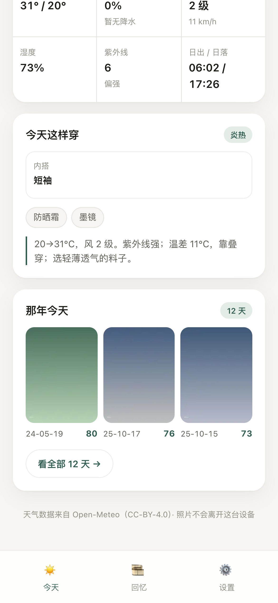
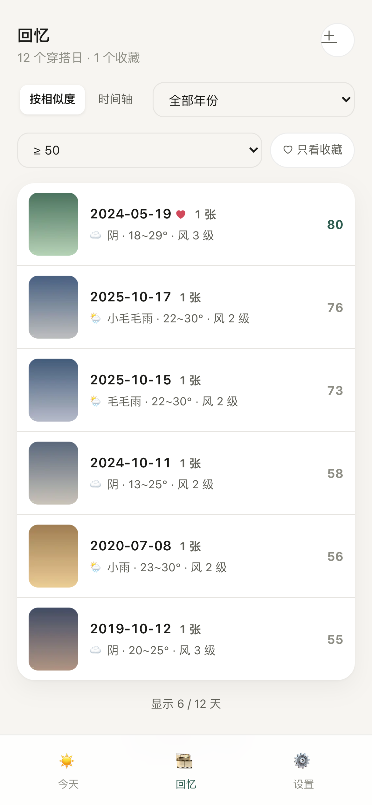
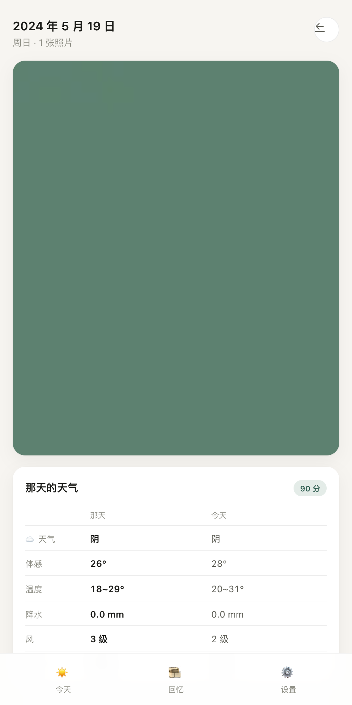

# outfit-rewind

**今天穿什么，以及那些天气差不多的日子里，你穿了什么。**

一个纯前端的小工具：读今天的天气，给一句人话的穿衣建议；再从你本机的相册里，找出 2015 年以来「体感、风、湿度」和你今天最像的那些日子，看看那天的你穿了什么。

没有账号，没有服务器，**照片一张都不上传**。

在线试用：https://ch9loe-2.github.io/outfit-rewind/

  

## 现在能做什么（v0.3）

- [x] 定位 / 手动选城市（内置 353 个城市，支持拼音/首字母，断网也能选），Open-Meteo 实况与今日预报
- [x] 全量指标：最高最低温、体感、降水概率与降水、风速、湿度、紫外线、日出日落
- [x] 规则化穿衣建议（三层穿法 + 配件 + 理由），不调用任何大模型
- [x] **相册导入**：选文件夹（桌面，一次上万张）或分批选照片（移动端）
- [x] **EXIF 解析**：拍摄时间 + GPS；只读文件头，原图不入库
- [x] **聚合为「穿搭日」**：一天 = 一套；凌晨 0–4 点归前一天；连拍自动合并
- [x] **缺 GPS 时按邻近推断**：借用前后 3 天内最近一个有坐标的日子；仍无则回落到年份城市
- [x] **历史天气**：按 位置×年 批量拉取（2015 起），一年一次请求，缓存本机
- [x] **相似度排序**：6 维加权，缺失维度自动剔除并重归一化
- [x] **那天详情**：当天照片、那天 vs 今天的天气对照、权重分解
- [x] **年份城市 / 时间段城市**：搬过家或旅行时指定地点，优先级 照片坐标 > 时间段 > 年份 > 推断 > 常驻；时间段重叠时后添加的生效（会弹确认）
- [x] **收藏**：在「那天」页按 ♡ 收藏，回忆页可只看收藏
- [x] **两种视图**：按相似度排 / 按时间轴（按年分组）
- [x] **HEIC 兜底**：Chrome 解不了 HEIC 时按需加载 wasm 解码（1.3MB，只在遇到 HEIC 时下载）
- [x] 深浅色跟随系统、移动端优先、清空本机数据

## 怎么用

1. 打开首页，允许定位（或去设置里选城市）
2. 点「导入相册」，桌面选整个文件夹，手机分批选
3. 回到「回忆」，按相似度看那些天气相近的日子
4. 点进去看那天穿了什么、天气差在哪

## 本地运行

    pnpm install
    pnpm dev

构建：

    pnpm build

## 部署

站点走 `gh-pages` 分支，一条命令：

    ./scripts/deploy.sh

首次使用需要在仓库 **Settings → Pages → Source** 里选择 **Deploy from a branch**，分支 `gh-pages`、目录 `/`。

> 想改成 push 自动部署（GitHub Actions）也可以，但需要 token 带 `workflow` 权限，当前凭据没有。

## 相似度怎么算

六个维度加权，缺失维度自动剔除并重归一化：

| 维度 | 权重 | 归一化尺度 |
| --- | --- | --- |
| 体感均温 | 0.35 | 8°C |
| 日温差 | 0.15 | 6°C |
| 降水量 | 0.20 | log1p → 5 |
| 最大风速 | 0.12 | 20 km/h |
| 平均湿度 | 0.10 | 25% |
| 最大紫外线 | 0.08 | 6 |

    距离 D = Σ wᵢ · |xᵢ - yᵢ| / scaleᵢ
    得分 = 100 · exp(-D / 1.6)

用指数而不是线性，是为了让 90 / 95 / 98 这种「非常像」的日子之间仍然可区分。历史天气来自 ERA5 再分析，没有紫外线字段，所以实际参与计算的是前五个维度。

## 穿衣规则

按体感均温分 9 档（≥30、25、20、15、10、5、0、-5、极寒），给出内搭 / 中层 / 外套，再叠加 5 条修正：降水 ≥50% 加伞、风 ≥4 级外套升档、UV ≥6 提醒防晒、湿度 ≥85% 且闷热提醒透气面料、昼夜温差 ≥10°C 提醒叠穿。文案是模板拼接，不生成。

## 数据存在哪

IndexedDB 三个表：

- `photos`：每张照片的时间、坐标、尺寸（不含原图）
- `days`：聚合后的穿搭日
- `weather`：按 位置×年 缓存的历史天气
- `thumbs`：200px 缩略图

「设置 → 本机数据」能看到占用，也可以一键清空。

## 已知限制

- 浏览器读不到整个相册：桌面用文件夹选择，iOS 只能分批手选（要全库需要原生壳）
- **微信内置浏览器会限制定位和本地存储**，也可能把照片转存导致 EXIF 丢失；请「…」→ 在浏览器打开
- 没有 GPS 的照片依赖「年份城市」；否则会按默认城市取天气
- 已导入的照片不会因为改进解析而自动更新，需要「设置 → 清空本机数据」后重新导入
- HEIC 在非 Safari 浏览器走 wasm 解码，首张会多花 1–2 秒（之后走缓存）
- 历史天气是再分析数据，90 年代偏差较大；本项目从 2015 年起
- 免费额度：Open-Meteo 非商业 10,000 次/天；本项目按年批量取，日常几乎不耗

## 数据与许可

- 天气数据：[Open-Meteo](https://open-meteo.com/)，CC-BY-4.0，非商业免费额度
- 代码：MIT
- 照片：只在本机解析，不经过任何网络请求

## 边界

不做衣橱单品入库，不做 AI 生成文案，不做服务端。
