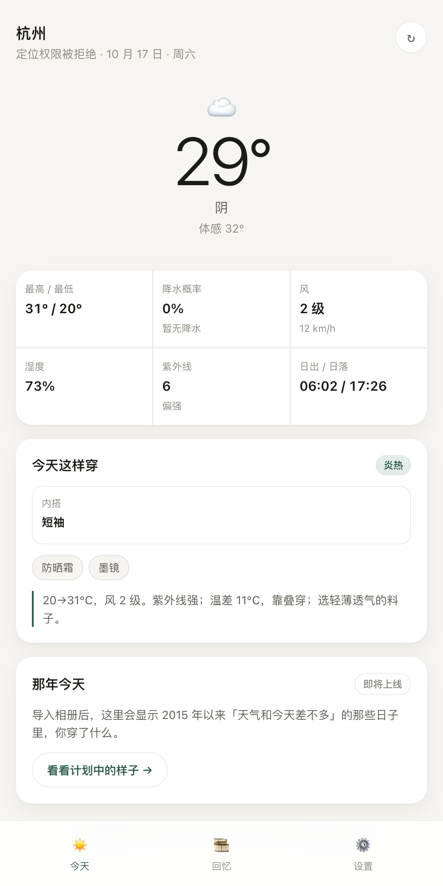
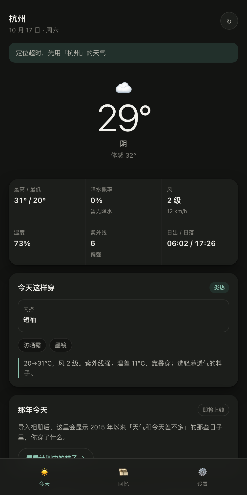

# outfit-rewind

**今天穿什么，以及那些天气差不多的日子里，你穿了什么。**

一个纯前端的小工具：读今天的天气，给一句人话的穿衣建议；再从你本机的相册里，找出 2015 年以来「体感、风、湿度、紫外线」和你今天最像的那些日子，看看那天的你穿了什么。

没有账号，没有服务器，**照片一张都不上传**。

在线试用：https://ch9loe-2.github.io/outfit-rewind/

 

## 现在能做什么（v0.1）

- [x] 定位 / 手动选城市，拉取 Open-Meteo 实况与今日预报
- [x] 全量指标：最高最低温、体感、降水概率与降水量、风速、湿度、紫外线、日出日落
- [x] 规则化穿衣建议（三层穿法 + 配件 + 理由），不调用任何大模型
- [x] 体感偏好（怕冷 / 正常 / 怕热）、历史起点（2015 起）
- [x] 跟随系统深浅色，移动端优先
- [ ] 相册导入与 EXIF 解析（v0.2）
- [ ] 历史天气按年批量拉取（v0.2）
- [ ] 相似度排序与「那天你穿了什么」（v0.3）

## 本地运行

    pnpm install
    pnpm dev

构建：

    pnpm build

## 部署

站点走 `gh-pages` 分支，一条命令：

    ./scripts/deploy.sh

首次使用需要在仓库 **Settings → Pages → Source** 里选择 **Deploy from a branch**，分支 `gh-pages`、目录 `/`。

> 想改成 push 自动部署（GitHub Actions）也可以，但需要 token 带 `workflow` 权限，当前凭据没有。

## 相似度怎么算（v0.3 用）

六个维度加权，缺失维度自动剔除并重归一化：

| 维度 | 权重 | 归一化尺度 |
| --- | --- | --- |
| 体感均温 | 0.35 | 8°C |
| 日温差 | 0.15 | 6°C |
| 降水量 | 0.20 | log1p → 5 |
| 最大风速 | 0.12 | 20 km/h |
| 平均湿度 | 0.10 | 25% |
| 最大紫外线 | 0.08 | 6 |

    距离 D = Σ wᵢ · |xᵢ - yᵢ| / scaleᵢ
    得分 = 100 · exp(-D / 1.6)

用指数而不是线性，是为了让 90 / 95 / 98 这种「非常像」的日子之间仍然可区分。

## 穿衣规则

按体感均温分 9 档（≥30、25、20、15、10、5、0、-5、极寒），给出内搭 / 中层 / 外套，再叠加 5 条修正：降水 ≥50% 加伞、风 ≥4 级外套升档、UV ≥6 提醒防晒、湿度 ≥85% 且闷热提醒透气面料、昼夜温差 ≥10°C 提醒叠穿。文案是模板拼接，不生成。

## 数据与许可

- 天气数据：[Open-Meteo](https://open-meteo.com/)，CC-BY-4.0，非商业免费额度
- 代码：MIT
- 照片：只在本机解析，不经过任何网络请求

## 边界

不做衣橱单品入库，不做 AI 生成文案，不做服务端。想要「真正扫描整个相册」，需要原生壳（Android 可用 Capacitor 打包，iOS 需要开发者账号）。
